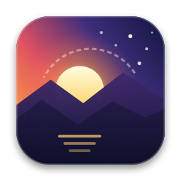
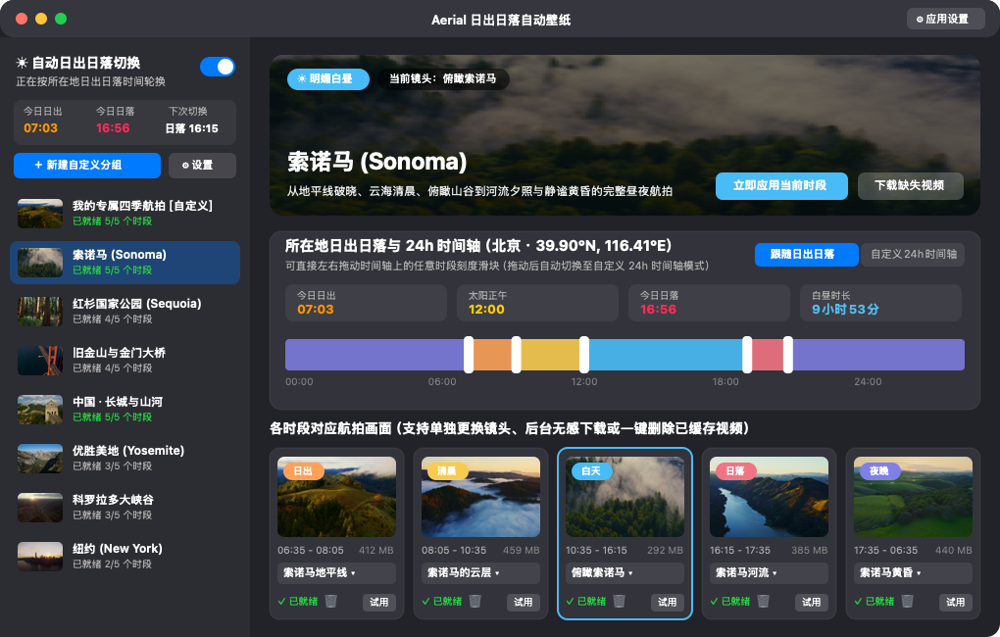

<div align="center">
  
  <h1>Aerial 日出日落自动壁纸 (autowallpaper)</h1>
  <p><strong>根据所在地真实天文日出日落时间或自定义 24h 时间轴，自动无缝切换 macOS 原生动态航拍（Aerial）壁纸与屏保</strong></p>
  <p>
    <a href="https://github.com/Firemount-34/autowallpaper/releases/latest">
      
    </a>
    
    
    
  </p>
</div>

---

## 🖥️ 界面展示

### 1. 应用主界面（航拍地点浏览 · 24h 可拖拽日出日落时间轴 · 5 时段镜头卡片）

<div align="center">
  
</div>

### 2. 状态栏（菜单栏）快捷弹窗与独立设置窗口

<div align="center">
  
</div>

---

## ✨ 核心功能

| 模块 | 功能亮点 |
| :--- | :--- |
| 🌅 **天文日出日落引擎** | 内置 NOAA 太阳位置算法，支持 **30+ 预设城市选择**、**系统 CoreLocation 定位** 或 **手动经纬度输入**，精确计算每日**日出、太阳正午、日落与白昼时长**，动态划分全天 5 个时段（`日出破晓` → `清晨朝霞` → `明媚白昼` → `日落黄昏` → `静谧夜晚`），并支持 `-60 ~ +60` 分钟偏移微调。 |
| 🕒 **直接拖拽 24h 时间轴** | 无需先切换模式，随时**直接左右拖动时间轴上的任意时段刻度滑块**（以 15 分钟为单位），拖动后自动切换至「自定义 24h 时间轴」模式；也支持一键将时间轴重新对齐至今日当地日出日落时间。 |
| 🗂️ **精选地点与自定义混搭分组** | 内置**索诺马 (Sonoma)**、**红杉国家公园 (Sequoia)**、**旧金山与金门大桥**、**中国·长城与山河**、**优胜美地**、**科罗拉多大峡谷**、**纪念碑谷**、**纽约**、**洛杉矶**、**香港**、**迪拜**、**伦敦**、**夏威夷**、**格陵兰**等地点组；支持**新建 / 编辑 / 删除自定义航拍分组**，从 macOS 全部 137+ 原生航拍镜头中自由跨地点混搭 5 个时段的壁纸。 |
| 📥 **无感后台下载与缓存清理** | 通过内核级 `kqueue` 实时同步系统 `/Library/Application Support/com.apple.idleassetsd/Customer/4KSDR240FPS` 目录真实状态；独立后台 HTTP 下载缺失视频，**下载期间不退出、不打断当前桌面壁纸**，下载 100% 落盘后自动无缝切换；支持按单个时段或整组**一键删除已下载视频文件**以释放磁盘空间。 |
| ⚙️ **独立设置与极致性能** | 独立的「应用设置」窗口支持自由切换**是否在程序坞 (Dock) 显示图标**、**登录 macOS 时自动启动**、**同步至屏幕保护程序**，并内置**实时内存 / CPU / 缓存体积监控**与**原壁纸一键还原**。应用体积仅 **1.9 MB**，闲置 CPU 占用 **0.0%**，内存占用仅 **~20 MB**。 |

---

## 📦 下载与安装

### 方式一：直接下载安装包（推荐）

前往 [**GitHub Releases 页面**](https://github.com/Firemount-34/autowallpaper/releases/latest)（或仓库 [`release/`](./release/) 目录）下载：

- **[`autowallpaper-1.0.dmg`](https://github.com/Firemount-34/autowallpaper/releases/latest)**（**1.6 MB**，双击打开后将 `autowallpaper.app` 拖入右侧 `Applications` 文件夹即可）
- **[`autowallpaper-1.0.zip`](https://github.com/Firemount-34/autowallpaper/releases/latest)**（**1.3 MB**，解压即用）

> **首次打开提示**：由于未进行 Apple 付费开发者公证，首次打开若提示无法验证开发者，请前往 **系统设置 ➔ 隐私与安全性**，滑到底部点击 **「仍要打开」** 即可。

### 方式二：通过 Xcode 源码编译

1. 克隆本仓库：
   ```bash
   git clone https://github.com/Firemount-34/autowallpaper.git
   ```
2. 使用 Xcode 16+ 打开 `autowallpaper.xcodeproj`，按 `Cmd + R` 编译运行。

---

## 🛠️ 工作原理

macOS 自带的动态航拍壁纸在系统设置中按单个镜头独立存放，无法随时间自动轮换。本工具通过：
1. 解析 `/Library/Application Support/com.apple.idleassetsd/Customer/entries.json`、`TVIdleScreenStrings.bundle` 及本地预览快照；
2. 在接管前自动备份 `~/Library/Application Support/com.apple.wallpaper/Store/Index.plist`；
3. 在日出、清晨、白昼、日落、夜晚各时间节点（以及系统开机、登录、睡眠唤醒事件触发时），动态更新 `Index.plist` 中的 `com.apple.wallpaper.choice.aerials` 配置并重启 `WallpaperAgent` 使新壁纸无缝生效。
